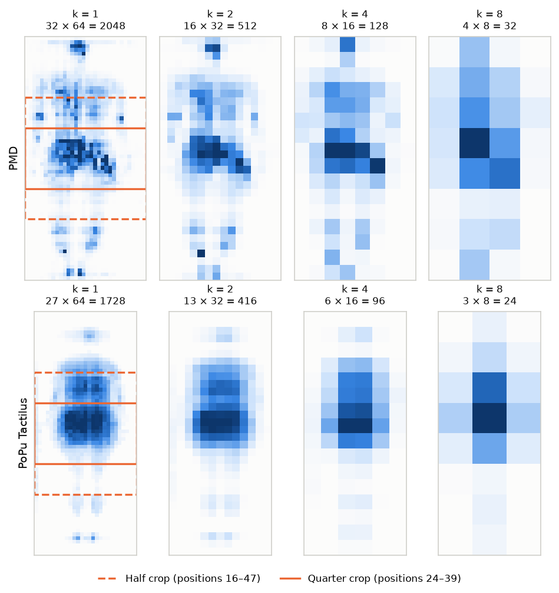
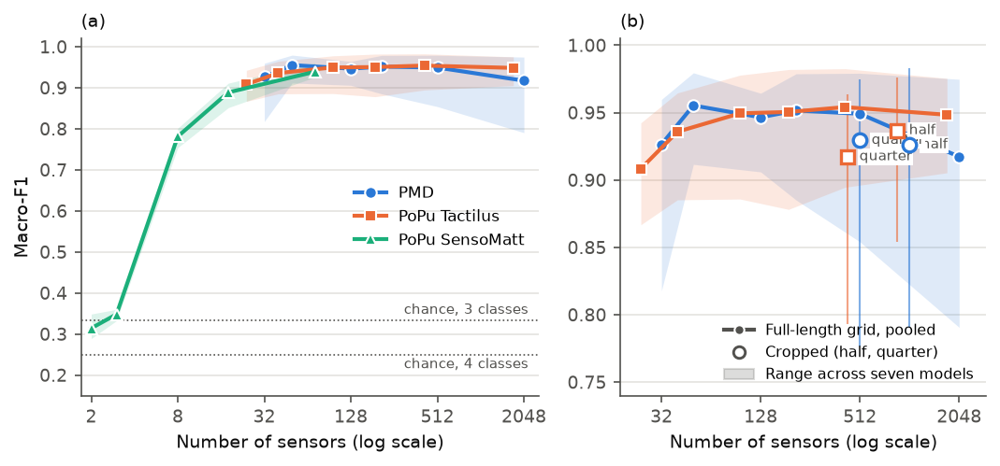
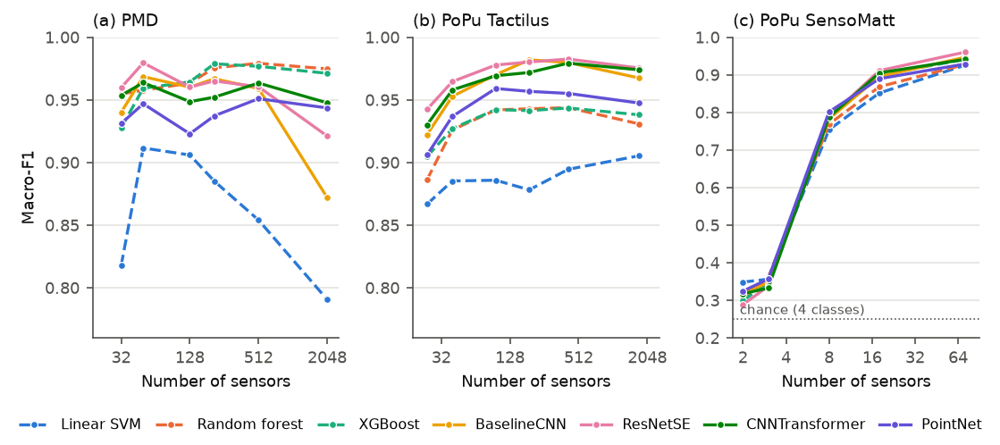

High-resolution pressure mats can classify how a person is lying in bed, which matters for pressure-ulcer prevention and patient monitoring. But high-resolution medical mats are expensive. This project asks a sharper question: <strong>what is the minimum resolution posture classification actually needs, and does "resolution" mean sensor density or coverage area?</strong>

<h2 class="research-heading">Two kinds of resolution</h2>

I separate two things that are usually conflated:

  

    Axis 1
    <h3>Density</h3>
    
Fewer sensors over the same area (downsampling).

  

  

    Axis 2
    <h3>Coverage</h3>
    
The same sensors over a smaller area (cropping).

  

<figure class="research-figure research-figure--narrow">
  
  <figcaption>Example frames from PMD (top) and PoPu's Tactilus mat (bottom). Moving right, neighboring sensors are averaged together, so the mat keeps its size but has fewer sensors. The orange lines mark the half and quarter crops, which keep the sensor spacing but cover less of the body.</figcaption>
</figure>

<h2 class="research-heading">Key findings so far</h2>

<ol class="findings">
  <li><strong>Far fewer sensors are enough</strong>: cutting the sensor count to about 1/16 (128 sensors on PMD, 96 on PoPu's Tactilus mat) causes no significant loss for nearly all models, and full resolution is rarely the best setting.</li>
  <li><strong>At a fixed sensor budget, keep the full body length</strong>: on PoPu, a sparse full-length layout beat a dense middle-only layout for 6 of 7 models (p &lt; 0.001). On PMD the two layouts were not significantly different.</li>
  <li><strong>A 72-cell mat under the mattress can match a 1,728-sensor mat</strong> with classical models, but drops to near chance once only one column is left across the bed.</li>
</ol>

<figure class="research-figure">
  
  <figcaption>Macro-F1 against the number of sensors, averaged over the seven models. The shaded band is the range across models. Left: all three mats. Right: a closer look at PMD and Tactilus, with the cropped mats shown as hollow markers.</figcaption>
</figure>

<figure class="research-figure">
  
  <figcaption>The same comparison for each of the seven models separately.</figcaption>
</figure>

  
All experiments use strict subject-independent validation (leave-one-subject-out on PMD, five folds split by volunteer on PoPu) across seven model families, so the numbers reflect performance on genuinely new users rather than leaked data.

  
<em>This page will be updated with figures, the full write-up, and code as the project develops. Code lives on <a href="https://github.com/ChengdongWeng">GitHub</a>.</em>

  <a class="btn btn--primary" href="https://github.com/ChengdongWeng">GitHub</a>

