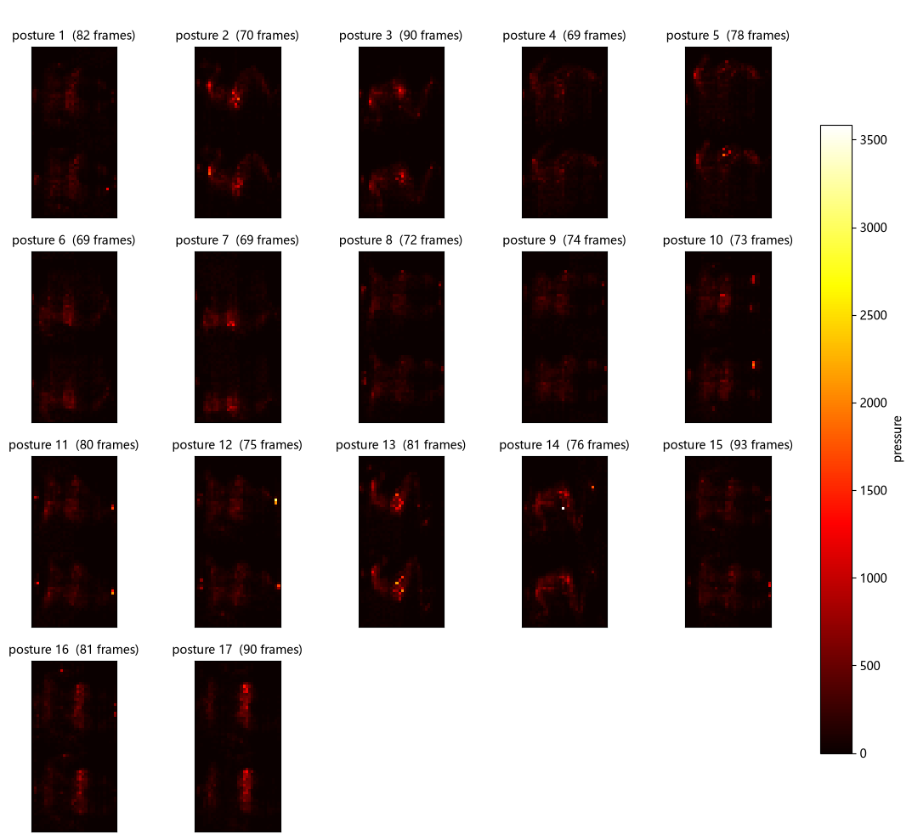
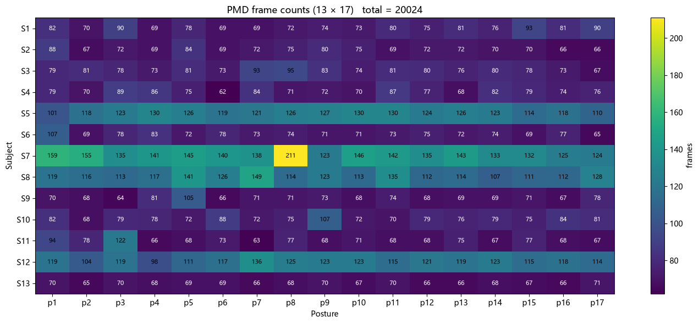
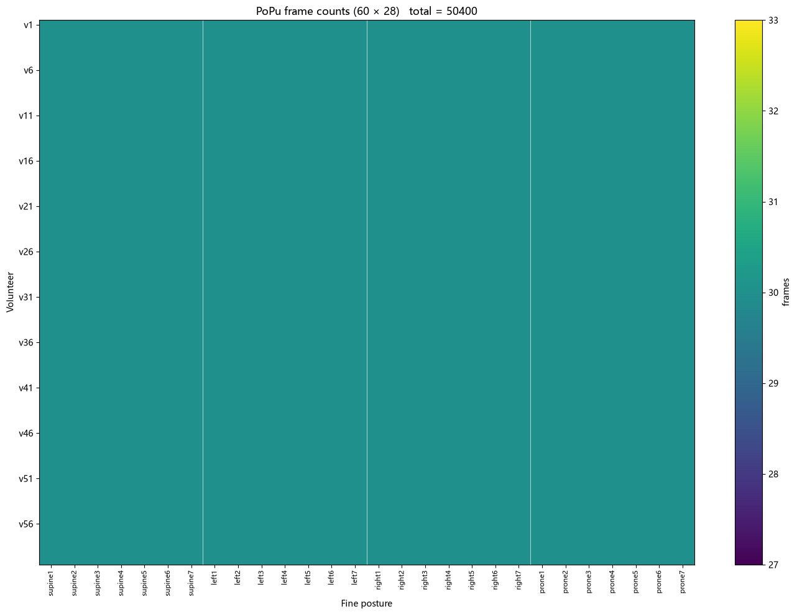

One file was working. The next step was to read everything: all 17 postures for one person, and then all 13 people.

The first try didn't even get that far. I had run my earlier cells in a different notebook window, so when I ran the new loader, Python had no idea where my data folder was. The error pointed at the line where I defined the function, not where I used it, and that confused me for a while. It turns out Python works out a function's default arguments at the moment the function is defined, not when it's called. If the default refers to a variable that doesn't exist yet, the definition itself fails. I changed the default to None and looked the folder up inside the function instead. A small thing, but I would never have guessed it.

Once the loader worked, I drew all 17 postures for subject 1 in one grid, each one averaged over its whole recording. The dataset comes with a document that describes them: 8 standard positions plus 9 extra ones. Some are plain lying on your back or on your side. Some are side-lying with one or two wedges under the torso, tilting it 30 or 60 degrees. Two are curled up in a fetal position. Three are lying on your back with the head of the bed raised.

*Subject 1, all 17 postures, each averaged over its whole recording.*

For my question I didn't need all 17. Like other papers that use this dataset, I grouped them into three classes: on your back, on your left side, and on your right side. Nine postures go into "back" and four into each side. There is no lying face down in PMD at all. I made a note of that, because PoPu does have it.

Grouping them this way makes the classes uneven. About 53% of the frames are "back", and roughly 23% each are left and right. If I only looked at overall accuracy, a model could get more than half right by always guessing "back". So I decided to judge models by macro-F1, which scores each class on its own and then averages them, so the two smaller classes count just as much as the big one.

Then I ran the loader on all 13 people and got 20,024 frames. Across postures the frame counts were fairly even. Across people they weren't. Subject 7 had much longer recordings than everyone else, up to 211 frames for one posture where most people had between 65 and 90.

*Frames per subject and posture in PMD. Subject 7's row stands out.*

I kept subject 7. Dropping someone because their data looks different is exactly the kind of choice that can make results look better than they really are.

There was also the question from my first picture. The dataset's page says readings go up to 1000, but the data goes up to about 3,800. There were three possible reasons on my list, and one of them was that I might be unfolding the numbers in the wrong order. The simplest explanation was that the mat's electronics output 12-bit numbers, which go up to 4,095, and that the page just described it wrong. That fit the numbers, so I went with it.

PoPu came next. I moved its folder into the project and read all 60 volunteers. It's organized as 4 main postures, including face down, each with 7 variations, and it was perfectly balanced: every volunteer and every posture had the same number of frames, 50,400 in total. Two things stood out. Its readings only go up to 1,024, a completely different scale from PMD, so the two datasets would need their own normalization. And in a typical frame only about 8.5% of its sensors are pressed at all. Most of each picture is empty. I also had the Georgia Tech dataset on disk, but it was recorded on a tilting robotic bed for a different purpose, so I set it aside.

*Frames per volunteer and posture in PoPu. Every cell is 30, so the whole chart is one color. Compare that with PMD above.*

The most important decision that week was how to split people into training and testing. The first rule in my plan was that the same person can never be in both. For PMD, with only 13 people, every person gets a turn as the test person. This is called leave-one-subject-out. In each of the 13 rounds, one person is the test, the next person in order is used for validation, and the other 11 train the model. For PoPu, 60 rounds would take far too long, so I split the volunteers into 5 groups of 12 and gave each group a turn as the test set.

Then there was the number of random seeds. One option was to use 3 seeds to save time. I wanted at least 5 in the final results. This is a software-only project, so I don't have any excuse for a weaker standard than a real paper would use. Three seeds are fine while I'm exploring, but the numbers I report will use five.

Finally I saved all of the splits into one file, splits.json, and decided never to regenerate it. If the groups changed from one experiment to the next, I wouldn't be able to tell whether a difference came from the lower resolution or just from different people ending up in the test set.
