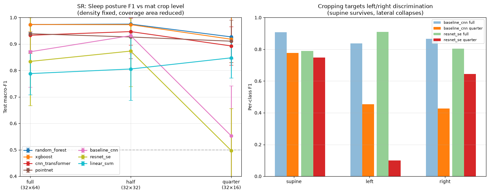
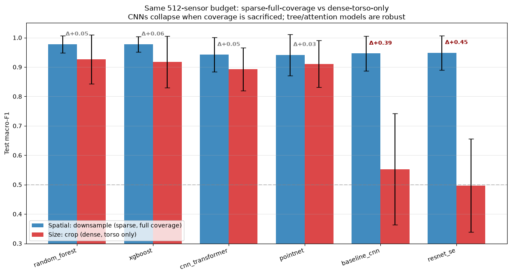

The third experiment tested the other way of making a mat worse. Instead of fewer sensors over the same area, I kept every sensor at its original spacing and cut the mat down so it covered less of the body. The cuts were along the length of the body, centered on the middle of the mat. Full was the whole 32 by 64 mat with 2,048 sensors, half was the middle 32 by 32 with 1,024, and quarter was the middle 32 by 16 with 512. I used the same plain settings as the first experiment, so the only thing changing between the three sizes was how much of the body the mat could see. Seven models, 3 sizes, 13 rounds and 3 seeds made 819 runs.

Before looking at the results, I checked one thing. The full size in this experiment is exactly the same setup as full resolution in the first one, so the two should give the same scores. For 6 of the 7 models they were within 0.004 of each other. The ResNet was off by 0.031, which is inside its normal spread between seeds. That told me the new code wasn't changing anything it wasn't supposed to.

Then the results. The classical models and PointNet lost a little at quarter size. The random forest went from 0.974 to 0.927. The two CNNs fell apart. The small CNN went from 0.871 at full size to 0.553 at quarter size, and the ResNet went from 0.834 to 0.497. In a three-class problem where the best models score above 0.97, that is a collapse.

*Left: every model at the three mat sizes. Right: the two CNNs by posture, full mat against quarter mat.*

The per-class scores showed where the damage was. For the ResNet, supine barely changed, minus 0.05. Right side dropped by 0.16. Left side went from 0.91 to 0.10. The model could still tell when someone was on their back, but it could hardly recognize left side anymore. My explanation was that cutting along the length of the body removes the head and legs. When someone lies on their back, the pressure under the middle of the body already looks like lying on your back. When someone lies on their side, a lot of what makes left different from right is where the shoulders, arms and legs end up, and those were the parts I was cutting off.

The comparison I cared about most was at 512 sensors, because both experiments had a setting with exactly that number. In the first experiment, 512 sensors meant 16 by 32 spread over the whole mat. Here it meant 32 by 16 packed into the middle. For the trees, PointNet and the Transformer model, the spread-out version was better by 0.03 to 0.06. For the small CNN it was better by 0.39, and for the ResNet by 0.45.

*The same 512 sensors, arranged two ways. Blue: spread over the whole mat. Red: packed into the middle quarter.*

So with the same number of sensors, a coarse mat covering the whole body did much better than a fine mat covering only the torso. For someone designing a cheap mat, that seemed like the most useful thing I had found so far: keeping the coverage matters more than keeping the sensors close together.

One more pattern showed up again. For several models, half size scored higher than full size. The small CNN went from 0.871 at full to 0.932 at half. Less input and a better score, the same direction as the upside-down U in the first experiment.

The meeting with my mentor was the same week. I prepared for it more than for any meeting so far, with the main figures and a list of questions I thought he might ask, each with my answer written out. After I went through the three experiments, he said, "Those are exactly the results we are aiming for." I had been nervous about this meeting for days, and hearing that was a huge relief. In July I had gone into a meeting ready to defend the radar idea and come out without it. This time the work held up.

He also gave me four new things to do. Report micro-F1 next to macro-F1. Turn the 512-sensor comparison into a proper figure. Combine cropping and averaging in one grid, so both kinds of damage can be seen together. And slide the small mat along the body to find the best place to put it. He also had questions about my earlier email. Was there a face-down class? Not in PMD. How did I average the sensors? A plain average of each block of neighbors. And were the readings at 4,095 a problem with the electronics, or real pressure being cut off at the top? I didn't have an answer to that one yet.
