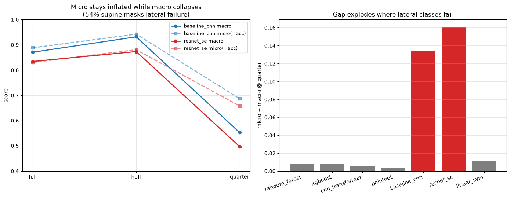

The first task from the meeting looked like the easiest: report micro-F1 next to macro-F1.

Macro-F1 is what I've been using since July. It gives each class its own F1 score and then averages the three, so on your back, left side and right side each count for one third, no matter how many frames they have. Micro-F1 throws all the predictions into one pile and scores them together. When I looked up how it's calculated, I found that for my problem, where every frame has exactly one label, micro-F1 is exactly the same number as plain accuracy. So I didn't have to train anything. My CSV already had a test accuracy column for every run, and the whole task was reading numbers I already had.

For most models the two scores were almost the same. Even at quarter size, the difference was around 0.01 or less for the random forest, XGBoost, the Transformer model, PointNet and the linear SVM. The two CNNs were the exception. At quarter size the small CNN had a macro-F1 of 0.553 and an accuracy of 0.687. The ResNet had 0.497 and 0.658. That's a gap of 0.13 and 0.16, right where their left and right scores had collapsed.

*Left: the two CNNs, macro-F1 (solid) against accuracy (dashed). Right: how far accuracy sits above macro-F1 at quarter size, for each model.*

It comes from the class balance. More than half of the PMD frames are on your back. A model that still gets those right but mixes up left and right keeps more than half of its answers correct, so its accuracy still looks okay. Macro-F1 doesn't let that slide, because the two side classes count as much as the big one. If I had only reported accuracy, a ResNet that could barely recognize the left side would have shown up as a model at 66 percent. Not great, but not obviously broken either.

I chose macro-F1 in July for exactly this reason, after counting how many frames each class had. Back then it was just a rule I set before starting, and I had no idea if it would ever matter. Seeing the two lines split right where the side classes fail was the first time it actually made a difference. I was pretty happy about that.

From now on I'll keep macro-F1 as the main score and put accuracy next to it, with one sentence explaining why they're different. The figure above is my first draft of that. The next task was the question from the meeting I still couldn't answer.
