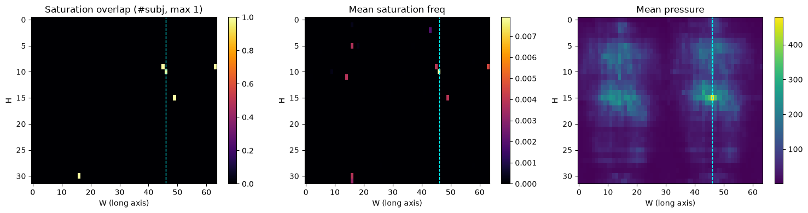

At the meeting my mentor asked about the readings at 4,095: was that a problem with the electronics, or real pressure getting cut off at the top of the range? I had been using those readings as part of my explanation for the information effect. I needed an answer and I didn't have one.

I started by thinking about what each answer would look like in the data. If it was the electronics, like a broken or stuck sensor, the same spots on the mat would hit 4,095 for lots of different people, since the hardware stays the same. If it was real pressure being cut off, the 4,095 readings would sit where the body presses hardest, which in PMD is around column 46, near the hips. So I wrote a check that counts how often each pixel hits 4,095 for each person, counts how many people each pixel does it for, and compares that map with the map of average pressure.

The plain count changed things before I even got to the maps. For 11 of the 13 people, the share of readings at 4,095 was 0.00 percent. For the other two it was 0.01 percent. Then I counted how many people reached 4,095 at all, and it was 7, not the 8 I had written in my summary. Even that number was misleading. Most of those 7 people only had a few pixels touch the ceiling in a few frames. A pixel touching the ceiling once is not the same as the data being cut off, and in my summary I had treated them as the same thing.

The maps said the same. No pixel hit 4,095 for more than one person, so it isn't a fixed spot in the hardware. The column where it happened most was around 16, nowhere near the pressure peak at 46, and the correlation between the two maps was only 0.11. So it isn't following the body either.

*Left: how many people each pixel hit 4,095 for, never more than one. Middle: how often it happened. Right: average pressure. The dashed line marks column 46, where the pressure is highest.*

My answer to my mentor was neither. There's almost no saturation in PMD, and what little there is looks like random noise in single sensors.

That meant I had to take something back. In my summary I had written that the 4,095 readings might support the information effect, the idea that the full-resolution picture has detail that hurts some models. The numbers don't support that at all. I wrote it straight into my reply: I ran the check, there's almost nothing there, and I'm dropping what I said before.

It was a little embarrassing. I had written that sentence pretty confidently, and one afternoon of checking was enough to knock it down. Still, I'd much rather catch it myself than have someone else catch it later. And only the explanation is gone, not the observations. The small CNN still didn't recover with regularization, and half a mat still beat the full mat for several models. None of that depended on saturation. I just don't know why it happens anymore.

The rest of the data check came back clean: no missing values, nothing out of range, no stuck pixels, and at most 4 empty frames per person. One more small thing. The dataset's web page says the values go from 0 to 1,000, but the raw files go up to 4,095. I'll mention that in the report.
