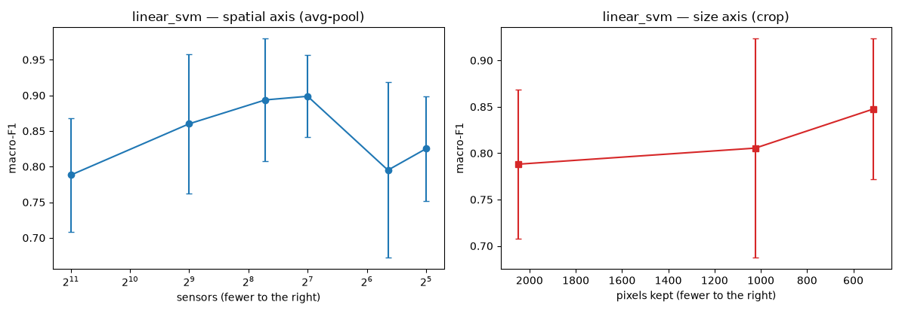

Without saturation, I had an effect and no explanation. Something in the full-resolution picture seemed to hurt some models, and better training didn't fix it for the small CNN. But the small CNN is still a neural network with around 30,000 parameters. Someone could say it was overfitting in a way my three regularization settings just didn't catch. I wanted a test where that argument would be a lot harder to make.

The linear SVM was the natural one to look at. It's the simplest model I have. All it can do is draw straight boundaries between the classes, so it has much less room to memorize individual people than any of the networks. If even the linear SVM does better with less input, then "the model is too big for this data" stops being a good explanation.

And it did. With averaging, its macro-F1 went from 0.788 at full resolution to 0.899 at 8 by 16, which is 128 sensors. With cropping, it went from 0.788 at full size to 0.848 at quarter size. On the cropping side, it was the only model whose score went up at every step as the mat got smaller.

*The linear SVM. Left: fewer sensors from averaging. Right: a smaller mat from cropping. Error bars show the spread over folds and seeds.*

The error bars are wide, so I didn't want to rely on the averages alone. Every run has a partner run with the same test person and the same seed, one at full resolution and one with less input. With 13 rounds and 3 seeds that makes 39 pairs, and for each pair I can check whether the smaller input scored higher. For averaging, comparing 8 by 16 with full resolution, it scored higher in all 39 pairs, by 0.111 on average. For cropping, comparing quarter with full, it was higher in 30 of the 39 pairs, by 0.060 on average. A paired test gave p < 0.001 for both.

There are two limits I need to keep in mind. A linear SVM has low capacity, but not zero. With 2,048 inputs it still learns 2,048 weights for each class from only 11 people, so it can overfit a bit. This result makes overfitting much less likely as the explanation, but it doesn't completely rule it out. Also, this doesn't mean fewer sensors are simply better. The linear SVM is the weakest model overall, and its curve drops again below 8 by 16, down to 0.795 at 5 by 10. What it does show is that the full mat records a lot of detail that doesn't help with posture, and a simple model can get distracted by it.

Right now this is the clearest evidence I have for the information effect, and it came from the model I mostly added as a simple baseline. I'm planning to put this figure in the report. With PMD mostly done, the next step was to see if any of this holds up on a second dataset.
