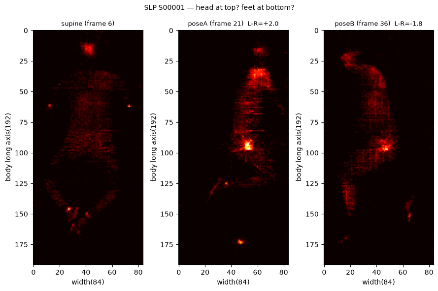

To check whether my PMD results hold anywhere else, I needed a second dataset. The first one I tried was SLP. My access request had been approved and the data was on my laptop. I used the part recorded in a room set up like a home, which has 102 people. The other part, recorded in a room set up like a hospital, has 7 people and no pressure data at all, so I skipped it.

Each SLP person has 45 pressure frames. After looking at several people and at the names of the official example images, I was sure of the order: frames 1 to 15 are on the back, 16 to 30 are on one side, and 31 to 45 are on the other side. The problem is "one side." The dataset tells you which frames are side postures, but not which side. To put SLP next to PMD, every frame I call "left" in SLP has to be the same physical side as "left" in PMD. Otherwise the comparison means nothing.

SLP does include 14 body joint positions for every frame, things like shoulders, hips and knees. They were marked on camera images, not on the pressure map, but each person comes with a small matrix that converts camera coordinates into pressure-map coordinates. So my plan was to use the joints to figure out which way each person rolled.

I already had a rule in my notes: check whether the right shoulder is above or below the left shoulder. When I tested it on all 102 people, it didn't work. The coordinate it used runs from head to feet, not across the bed, so it was measuring the wrong direction. I tried two other ideas. Looking at where the pressure is centered across the bed only gave a clear answer for 54 of the 102 people, because it can't tell "rolled to one side" apart from "lying a bit off-center on the mat." Comparing the two shoulders directly didn't work well either. People put their arms in all kinds of places when they lie on their side, and that pulls the shoulder joints around.

*One SLP person in all three segments: on their back, the first side posture, and the second side posture. The titles are my working notes from that day.*

What finally worked was using the whole body instead of a single joint. For each frame I convert all 14 joints onto the pressure map and average their positions across the bed. Then I subtract the same average from the frames where the person is on their back, so what's left is just how far the body moved. For each side segment I take the median of that shift instead of the mean, so a few strange frames can't flip the result. If the two side segments moved in opposite directions, that person gets a label. This worked for 99 of the 102 people. The last three were unclear. One hardly moved at all in one segment. The other two moved the same way in both segments, and one of them also had a strange ring shape in the frames on their back. I left those three out.

I also found something about my own code. I had assumed PMD's left and right came from some geometric rule that I could reuse. When I read my loader again, I saw that they come straight from the posture names in the dataset's documentation. So there isn't one rule that covers both datasets. What I can say is that SLP's labels are consistent within SLP. If SLP's "left" happens to be the mirror of PMD's, the names would be swapped, but that wouldn't change how well left and right can be told apart, and that's what I'm measuring. I'll write that in the report clearly instead of claiming more than I showed.

While I was comparing the two datasets, I checked PMD's orientation one more time. I averaged 90 frames of one person lying on their back, using my usual 32 by 64 reading, and got a clear picture: two matching bands and a high-pressure spot near the lower back. It looked right to me, so I moved on.

The left and right problem took several days. By the end, the science part of SLP was figured out, but I hadn't written any of the loading code. Meanwhile PoPu was almost ready to run. My mentor had suggested it at the meeting, its labels come straight from the file names, and it has a face-down class that PMD and SLP don't have. So I put SLP on hold and decided to run PoPu first.
