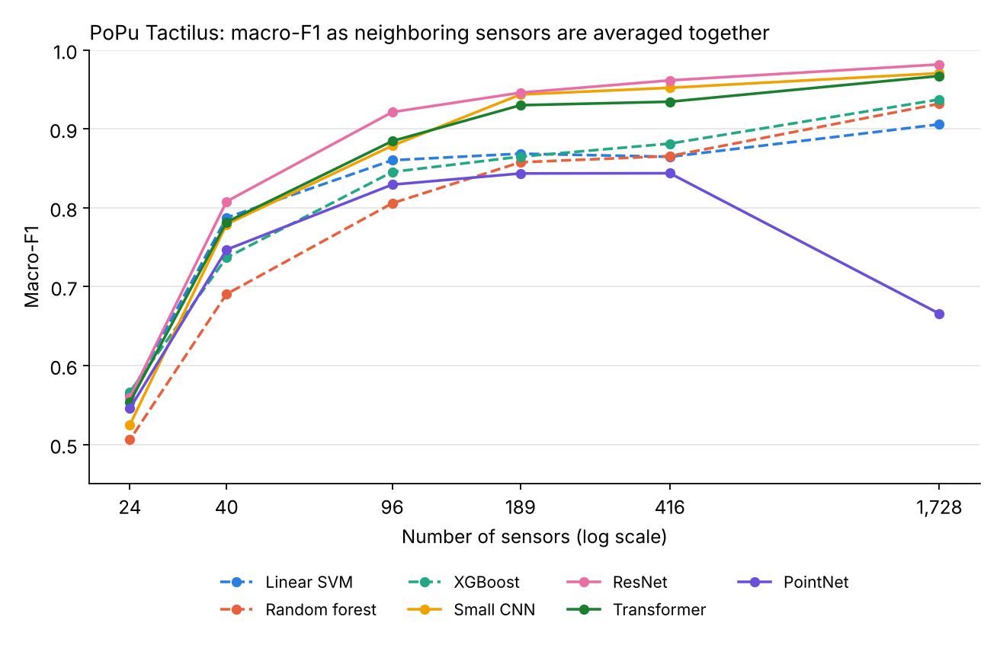

PoPu's main mat, Tactilus, is 27 by 64, a different size from PMD's 32 by 64. Before the full run I made sure every model could handle the new shape, especially at the smallest resolutions where a 27-row mat gets very thin. I ran all seven models at three resolutions on one fold, 21 runs in about five minutes, and none of them crashed. Then I started the full experiment: 7 models, 6 resolutions, 5 folds and 5 seeds, which is 1,050 runs. Each fold tests on 12 volunteers, validates on 12 and trains on the other 36. It took about 14 hours, and all 1,050 runs finished without a failure.

Here are the average macro-F1 scores. The numbers under each resolution are how many sensors are left.

| Model | 1,728 | 416 | 189 | 96 | 40 | 24 |
|---|---|---|---|---|---|---|
| ResNet | 0.982 | 0.961 | 0.946 | 0.921 | 0.808 | 0.559 |
| Small CNN | 0.971 | 0.952 | 0.944 | 0.879 | 0.779 | 0.525 |
| Transformer | 0.967 | 0.934 | 0.930 | 0.884 | 0.782 | 0.554 |
| XGBoost | 0.937 | 0.881 | 0.865 | 0.845 | 0.737 | 0.567 |
| Random forest | 0.932 | 0.866 | 0.858 | 0.806 | 0.691 | 0.506 |
| Linear SVM | 0.906 | 0.865 | 0.869 | 0.860 | 0.787 | 0.562 |
| PointNet | 0.666 | 0.844 | 0.843 | 0.829 | 0.747 | 0.545 |

*Each line is one model, averaged over 5 folds and 5 seeds.*

The main density result carried over. Every model stayed at 0.80 or above down to 96 sensors, and the ResNet was still at 0.921 there. Things only fell apart at the very end, at 24 sensors, where everything dropped to about 0.5 to 0.57. The spread across folds and seeds was small, mostly 0.01 to 0.04, so this pattern is stable. Some other things matched PMD too. The linear SVM held up well at low resolution, 0.860 at 96 sensors, and the tree models sat in the middle.

The upside-down U didn't carry over, though. On PMD, the ResNet and the small CNN did worst at full resolution. On PoPu they did best at full resolution: 0.982 and 0.971. The only model with a dip was PointNet, which scored 0.666 at full resolution and 0.844 one step down. That's a big jump, and I don't fully understand it yet.

I was a little disappointed at first. The upside-down U was the most surprising part of my PMD results, and I had hoped to see it again. But a second dataset is supposed to be a real test, so I wrote down what actually happened. One possible reason is the number of people. PMD only has 11 training people per round, and PoPu has 36. If the dip on PMD was mostly overfitting, more people would make it much harder to overfit, and the dip would shrink or disappear. That fits the ResNet result, where better training already removed most of the dip on PMD. It doesn't explain everything, because on PMD the small CNN didn't recover with better training. For now it's a hypothesis, and that's how I'm going to describe it.

PoPu also recorded every pose on a second mat at the same time, a much smaller one. I hadn't looked at it closely yet, and it was next.
