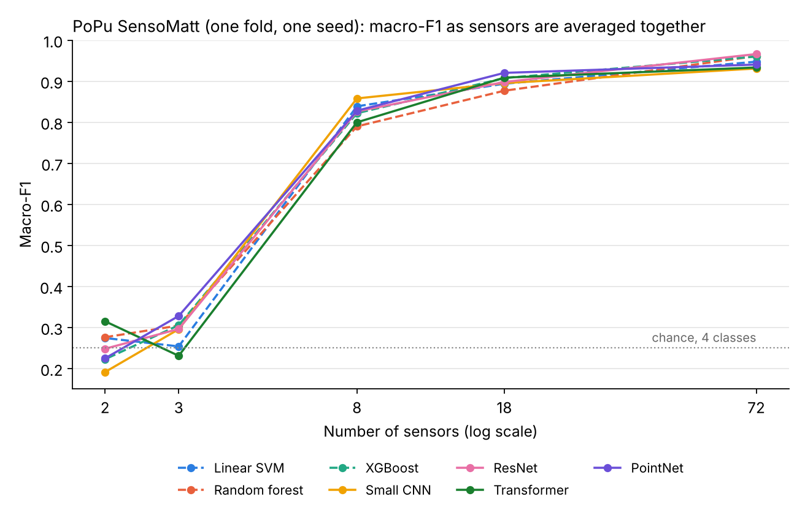

PoPu's second mat is called SensoMatt. It has only 12 by 6 sensors, 72 in total, and it sits under the mattress instead of on top of it. Every recording in PoPu was taken on both mats at the same time, so the people and the poses are exactly the same as on Tactilus.

What makes it interesting is that it's a real low-resolution mat. Everything I had done so far was taking a high-resolution mat and averaging its sensors together on a computer. That shows what a cheaper mat might do. SensoMatt is an actual mat that was built with very few sensors, so it can show what one really does.

Before setting up a full run, I did a quick probe: all 7 models at 5 resolutions, on one fold with one seed, 35 runs. The whole thing took about four minutes because the inputs are so small. I couldn't go down by a factor of 8 like on the other mats, because 6 columns divided by 8 leaves zero columns, so the smallest setting was 2 sensors.

| Model | 72 | 18 | 8 | 3 | 2 |
|---|---|---|---|---|---|
| ResNet | 0.966 | 0.898 | 0.826 | 0.296 | 0.248 |
| Random forest | 0.961 | 0.877 | 0.790 | 0.305 | 0.276 |
| XGBoost | 0.960 | 0.908 | 0.822 | 0.305 | 0.223 |
| Linear SVM | 0.948 | 0.894 | 0.839 | 0.254 | 0.274 |
| PointNet | 0.940 | 0.920 | 0.828 | 0.328 | 0.225 |
| Transformer | 0.933 | 0.909 | 0.800 | 0.231 | 0.315 |
| Small CNN | 0.931 | 0.895 | 0.858 | 0.296 | 0.191 |

*One fold and one seed, so treat the exact numbers as rough. The dotted line is chance for four classes.*

At its normal 72 sensors, every model scored between 0.93 and 0.97. For comparison, the full Tactilus mat has 1,728 sensors, and the best model there scored 0.982. A mat with 24 times fewer sensors was only a few points behind.

There was also a clear floor. With 8 sensors the models still got 0.79 to 0.86. With 3 sensors they all dropped to between 0.23 and 0.33, which is around chance for four classes. So for four postures, the smallest useful number of sensors on this mat is somewhere between 3 and 8. At 3 sensors there is only one column left across the bed. My guess is that this leaves the models almost nothing to tell the side postures apart, which would explain why everything drops at once.

I was really excited about this one. It's the most direct answer to my original question so far. But it's one fold and one seed, so the exact numbers will move. I set up the full run, 7 models, 5 resolutions, 5 folds and 5 seeds, which comes to 875 runs. I checked the plan and haven't started it yet, so for now these are probe numbers and I'll call them that.

My mentor had also asked me to start writing all of this up as a paper, and that was what I spent most of the next two weeks on.
