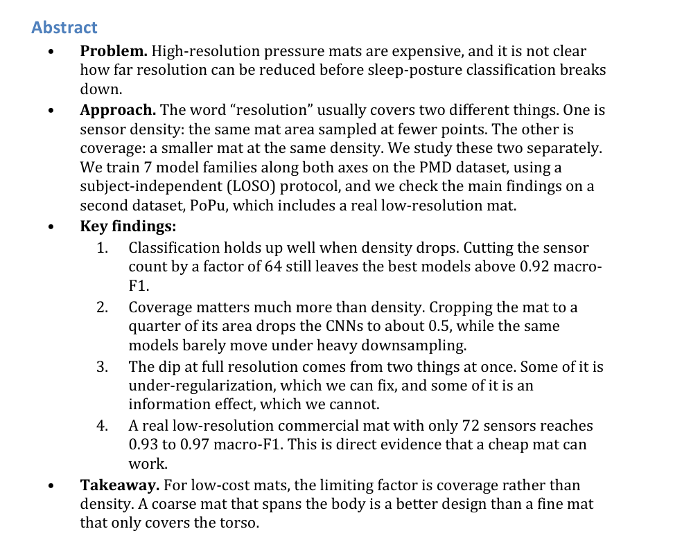

At the August meeting my mentor said it was time to start writing a paper. I had never written a paper like this on my own before. I had read a lot of papers for this project, but reading one and writing one are very different things.

I started from the structure I knew, seven sections from the introduction to the conclusion. For results I had plenty: the averaging experiment, the cropping experiment, the regularization check, the linear SVM test, and the two PoPu mats. I made five figures and put them in. Over a couple of weeks the draft grew into something that looked complete to me, and I sent it to my mentor before our next meeting on September 15.

At the meeting he went through it with me. He had only gotten it right before the meeting, so he read it quickly, and he said he would send detailed comments by email later. Even from a quick read, the main problems were clear, and they were bigger than I expected.

The structure was messy and missing pieces that a real journal paper needs. A lot of it was written as bullet points, more like a blog post than a paper. Even where I wrote full paragraphs, the language was nowhere near the way journal papers are written. And the biggest one: there were no references at all. Not a single citation anywhere in the paper. I had read and compared other studies, but none of that was in the draft. He also had smaller points. The paragraph about subject-independent testing belongs in Methods, not the introduction, and the list of contributions should move to the Discussion. The title wasn't settled, and neither was which journal to send it to. He said he would suggest some journals, and I should look too.

*The abstract of my first draft. Most of the paper was written like this, as labeled bullet points.*

It was hard to hear. I had walked in thinking the paper was basically done and would only need small fixes. I walked out realizing I didn't really know what a proper paper looks like yet. The experiments were there, but the paper around them wasn't.

After a day or two it felt more manageable, because the problems were concrete. The structure is probably the easiest part. I'm going to rebuild it with the usual Introduction, Methods, Results and Discussion layout, using papers from the journals I'm considering as examples. References will take longer, because I have to go back through everything I read and find the papers that actually support each claim. The language is the part I'm least sure how to fix. Most of what I wrote still reads like my own notes.

None of his comments were about the experiments themselves, which helped a little. But it means the next few weeks are going to be a rewrite.
