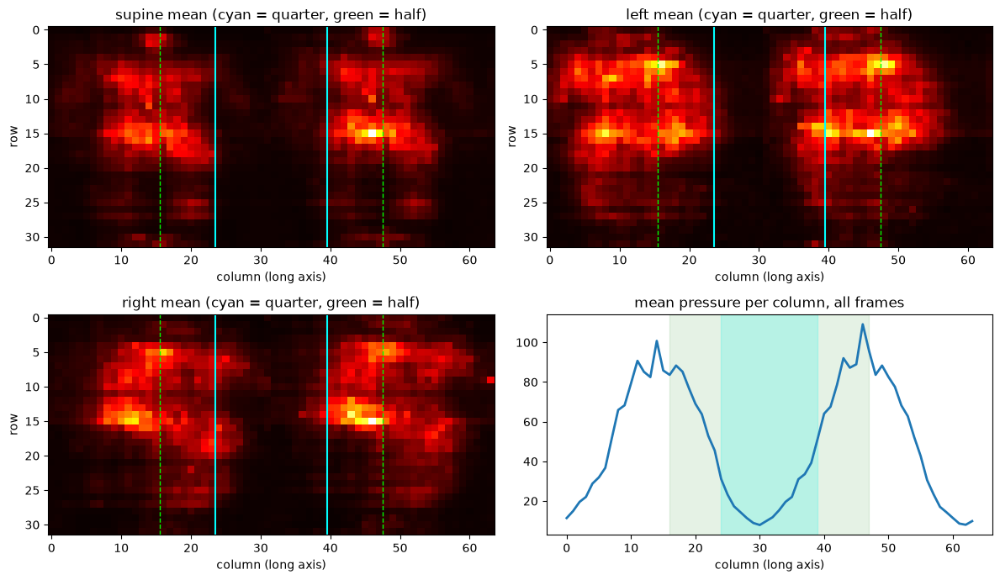
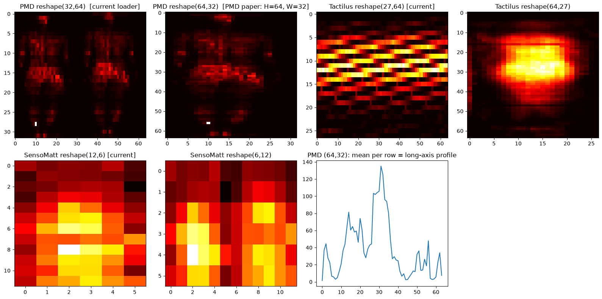

Today I was supposed to send my mentor the full draft. It was almost ready. The last experiment was running on the GPU, the quarter-size mat again with the better training settings from August, and while it ran I was filling in one of the red notes in the Methods section. The note asked me to confirm which parts of the body the quarter crop actually covers.

To answer it, I averaged the pressure maps of all 13 PMD subjects for each posture and drew lines where the half and quarter crops begin and end. I expected one body, with the torso inside the quarter crop.

Every map had two bodies. They lay side by side, almost identical, with an empty band down the middle, and the quarter crop sat right on that empty band. When I added up the pressure, the quarter crop kept only 11 percent of it, even though it was supposed to be the middle of the body.

*Average pressure for each posture across all 13 PMD subjects, read the way my code had been reading it since July. Cyan lines mark the quarter crop and green lines the half crop. Bottom right: average pressure per column, with almost nothing in the middle.*

I had seen this picture before. In July, the first frame I plotted looked like two bodies lying side by side, and I explained it with symmetry: a person on their back presses into the mat about the same on the left and the right. That explanation doesn't work here. Lying on your side isn't symmetric, and the left and right maps had two bodies too.

So I went back to the PMD paper. It says each frame has 64 rows along the bed and 32 columns across it. My code had been folding the 2,048 numbers into 32 rows of 64. With that shape, each row of my picture was really two neighboring rows of the real mat joined into one, which gives two half-length copies of the person next to each other. The confusing part is that the same paragraph also calls it a "32 × 64 mat," which describes its width and length, and my note had taken that as rows and columns. The correct way is to read the frame as 64 by 32 and then turn it. When I plotted the same frame both ways, the correct version showed a single person.

Then I checked PoPu. Every Tactilus file has its own size written inside it: 64 rows and 27 columns. My loader ignored that and used 27 by 64, the size used when the mat is described in words. Read that way, a frame turns into diagonal stripes. The 72-sensor SensoMatt mat was the only one I had been reading correctly.

*Top row: PMD as my loader read it, PMD in the shape from its paper, Tactilus as my loader read it, and Tactilus in the shape written in its files. Bottom row: SensoMatt both ways, and PMD's pressure along the length of the body once it's read correctly.*

When that second picture came up, my mind went blank. I sat there looking at it and couldn't think of anything to do. The first clear thought I had was that it couldn't be real, because I remembered checking. And I had checked. I checked that every frame had 2,048 numbers and that the frame counts and labels matched the dataset. All of that passes whether the shape is 32 by 64 or 64 by 32, because both have the same number of values. The models didn't complain either. A wrong shape moves the same pixels to the same wrong places in every frame, so the models still learned the pattern and still scored above 0.9. And whenever something looked a little strange, I found an explanation. Column 46 was "near the hips." The ResNet failing on left side at quarter size was about "cutting off the shoulders and legs." Those explanations were about a picture that didn't exist.

The mistake goes back to my first night of setup in July. My note from that night said to fold each line into 32 rows of 64, and I followed it without ever comparing a raw frame with a figure from the PMD paper.

What it means is bad. Every experiment I have run on PMD and Tactilus used scrambled maps: the averaging experiment, the regularization experiment, the cropping experiment and the full Tactilus run, about 4,400 runs in total. The cropping results are the worst. The quarter crop kept the middle of my doubled picture, and that middle is really two strips along the edges of the real mat, so it cut the body out instead of keeping it. The only numbers that should still hold are the classical models at full resolution, because they don't care about the order of the pixels. The draft I was going to send today is built on everything else, including the conclusion about coverage behind the title my mentor turned down yesterday.

I tried to work out how much would have to change, and I couldn't even finish the list. Almost every table and figure in the draft would have to be redone, and so would most of the discussion and the abstract. The meeting with my mentor is on Monday, three days from now, and the plan was to go through a finished paper together. Now I don't know what the results will look like, or whether the main finding will still be there. Until today I thought the hard part was over. This is the first time in the whole project that I've been scared I won't be able to finish it.

The quarter-crop experiment that was running finished later, and its results don't count either. Before anything else, I need to fix the loader, check it properly this time, and tell my mentor.
