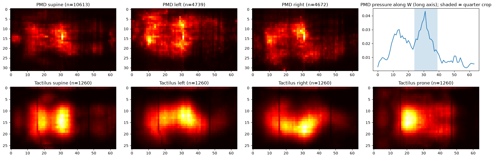
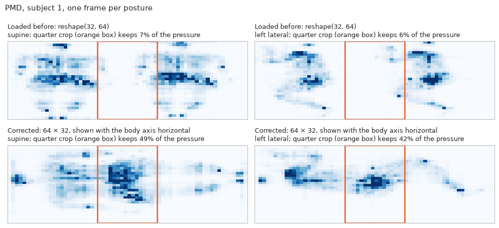

On Friday I had to write to my mentor. That email was supposed to be the one sending him the finished draft. Instead it started with "I'm afraid I have some bad news."

I didn't write it right away. For a while after finding the problem I couldn't do anything useful. Every time I thought about the draft, I thought about how many of its tables were wrong and how close Monday's meeting was. Once I had calmed down a little, I decided I didn't want the email to be only bad news. If I had to tell him the results were wrong, I also wanted to tell him the problem was fixed and the experiments were running again. So the email came last, and the loader came first.

The fix itself was small. PMD is now read as 64 by 32 and then turned, so the length of the body runs along the same axis my code already used, and nothing after the loader had to change. For PoPu, the loader now reads the size written in each file and stops with an error if it doesn't match what I expect, instead of using a size I typed in.

Checking took much longer than fixing, and this time I didn't want to skip anything. I compared what the loader returns with frames I reshaped by hand, and they matched exactly. I plotted the average map for every posture again, and each one showed a single person. The quarter crop now keeps about 43 percent of the pressure, mostly the pelvis and hips, instead of 11 percent. I also searched the whole project for any other place where a shape was typed in by hand, so the same mistake couldn't be hiding somewhere else.

*Average maps after the fix. Top: the three PMD postures, and PMD's pressure along the length of the body with the quarter crop shaded. Bottom: the four Tactilus postures.*

None of the old results were deleted. I moved them into a folder called `_invalid_reshape_bug`, so there is a record of what I ran and why it doesn't count, and all new results go into new files. I also added a check that runs before every experiment. It splits the mat in half along the length of the body and compares the pressure profiles of the two halves. In the old layout the two halves were nearly copies of each other, with a correlation above 0.95, so now the experiment refuses to start if the correlation is above 0.9.

Then I started everything again. The neural networks run on the GPU and the classical models run on the CPU at the same time. The linear SVM gave exactly the same results for all three seeds before, so this time it only runs one seed, which saves more than half a day. The regularization experiment can wait. I'll only redo it if the drop at full resolution still shows up with the correct data. It felt strange to press start on experiments I had already run once, but when the first new runs finished without errors, I felt a little better for the first time since I found the bug.

After that I wrote the email. I tried to keep it short without being vague. I explained what had happened: the frames were read as 32 by 64 when the paper says 64 by 32, so every picture showed two half-length bodies, and Tactilus had the same kind of error. I explained why my checks hadn't caught it and how I finally found it. Then I told him what it meant, which is that most of the results in the draft are not valid, and that the loader was fixed and the full rerun had started. At the end I wrote that I should have looked at the raw data much earlier, because that is true.

I didn't send the full draft. Most of its tables and figures had numbers I now knew were wrong, and once a wrong number is in someone's inbox it can get forwarded or remembered. I sent only the first three sections, the introduction, related work and methods, with the later sections reduced to headings. I also attached a picture of the same frames before and after the fix, with the quarter crop drawn on them.

*Subject 1, one frame per posture. Top: read the old way, where the quarter crop (orange box) keeps 6 to 7 percent of the pressure. Bottom: read correctly, where the same box keeps 42 to 49 percent.*

The thing I keep thinking about is how little it would have taken to catch this in July. One raw frame next to one figure from the PMD paper would have shown it. That is now the first thing I'll do with any new dataset, before writing a loader around it.

I'm not going to edit the posts I wrote about these experiments in August. They describe what I did and what I believed at the time, and that is what this blog is for. Once the new results are finished and checked, I'll write about what changed and what didn't.
